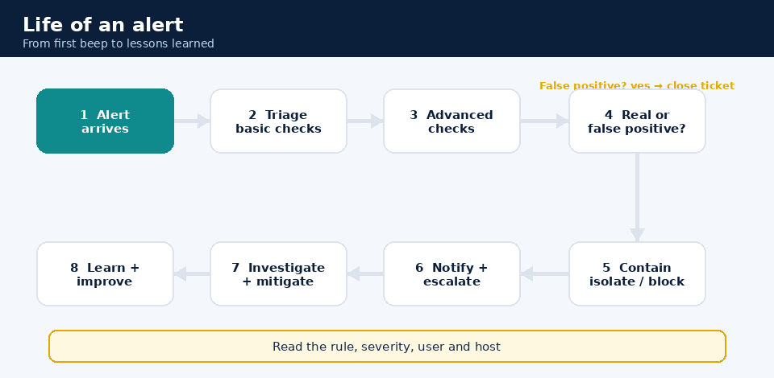
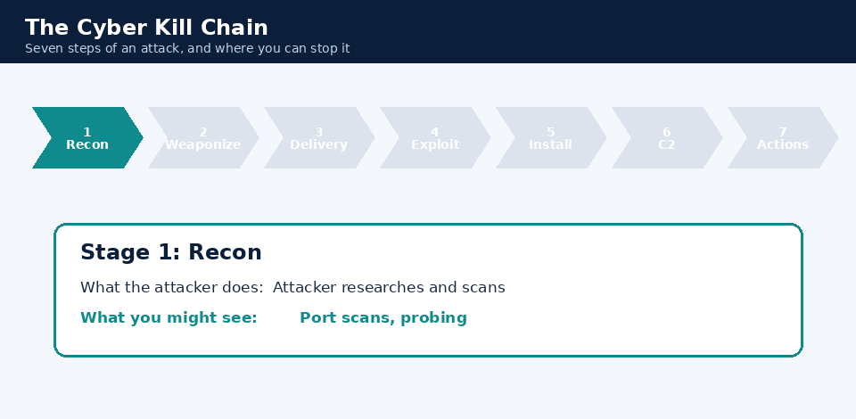
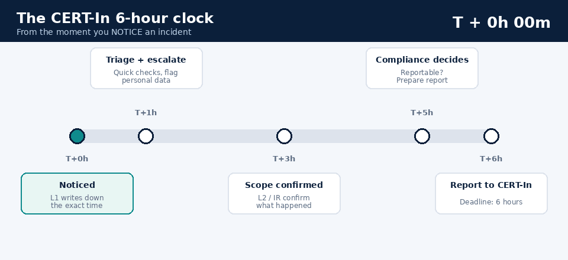
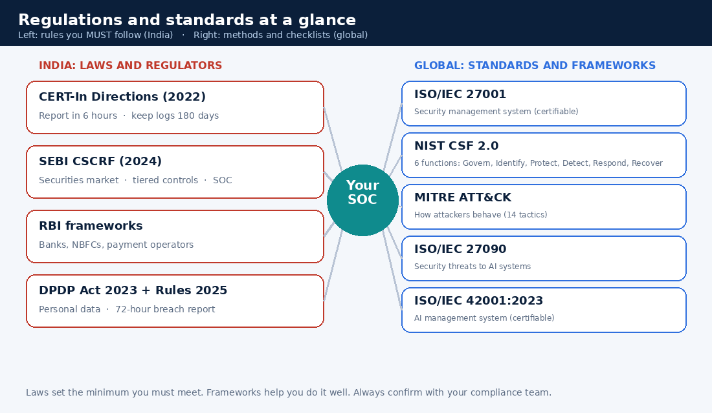
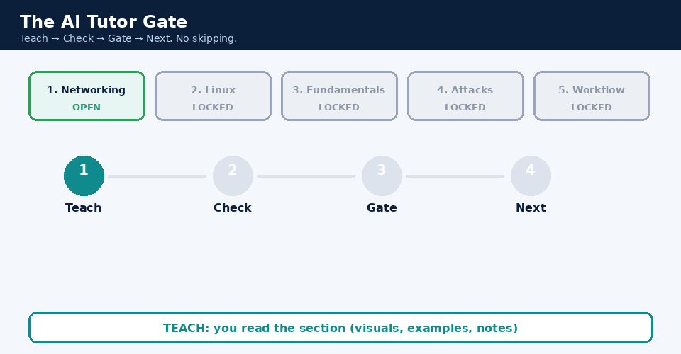
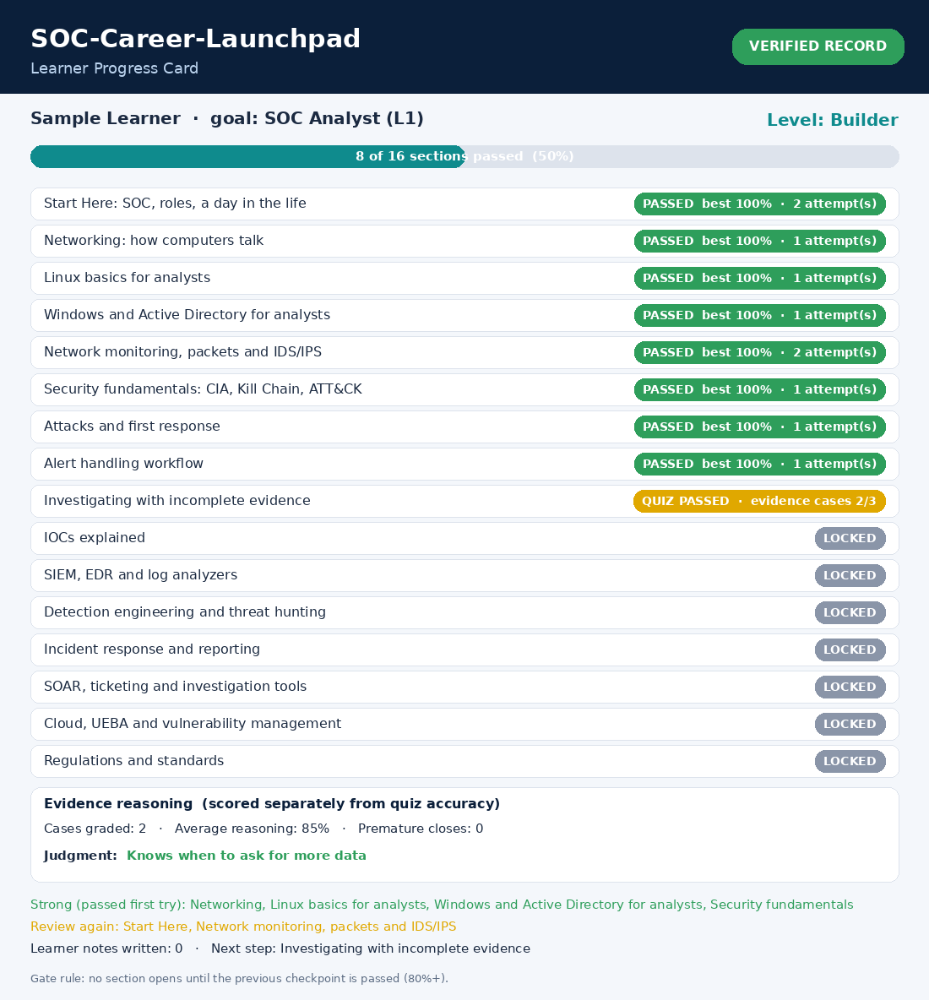

# 🛡️ SOC-Career-Launchpad

**A plain-English guide to starting a cybersecurity career in a Security Operations Center (SOC).**
What to learn, what to expect as an Intern or L1 Analyst, and how to be ready on Day 1.

> No jargon walls. No prior experience assumed. If you can use a computer and you're curious about how attackers think, you can start here.

---

## 🤔 Who is this for?

- Students and freshers who hear "cybersecurity" and don't know where to begin
- Career switchers (IT support, networking, sysadmin, even non-IT) who want to move into security
- New SOC Interns and L1 Analysts who want to feel confident before their first shift
- Team leads who want a simple onboarding reference for new joiners

## 🧭 What is a SOC, in one minute?

Think of a big office building. Guards sit in a control room watching CCTV cameras, door sensors and alarms. When something looks wrong, they check it, decide if it's real, stop the problem, and call the right people.

A **Security Operations Center (SOC)** is that control room for a company's computers, networks, cloud and users. SOC analysts watch alerts 24/7, separate real attacks from false alarms, and act fast to protect the company from **external threats** (hackers, malware, scammers) and **internal threats** (mistakes, misuse, or a bad actor with legitimate access).

Interns and L1 analysts are the **first line of defence**. Every big incident you read about in the news was first noticed by someone looking at a small alert.

---

## 🗺️ The Roadmap

| Step | Topic | What you'll learn | Read |
|------|-------|-------------------|------|
| 0 | Start here | What a SOC is, roles, a day in the life | [docs/00-start-here](docs/00-start-here/) |
| 1 | Networking | How computers talk: IP, ports, DNS, firewalls | [docs/01-networking.md](docs/01-networking.md) |
| 2 | Linux basics | Commands and logs every analyst uses | [docs/02-linux.md](docs/02-linux.md) |
| 3 | Security fundamentals | CIA, AAA, Kill Chain, MITRE ATT&CK, controls | [docs/03-security-fundamentals.md](docs/03-security-fundamentals.md) |
| 4 | Attacks & first response | What each attack looks like and what to do first | [docs/04-attacks-and-first-response.md](docs/04-attacks-and-first-response.md) |
| 5 | Alert handling workflow | Triage → investigate → escalate → close | [docs/05-alert-handling-workflow.md](docs/05-alert-handling-workflow.md) |
| 6 | IOCs explained | Clues attackers leave behind | [docs/06-iocs-explained.md](docs/06-iocs-explained.md) |
| 7 | SIEM, EDR & log tools | The tools you'll actually sit in front of | [docs/07-tools-siem-edr-log-analyzers.md](docs/07-tools-siem-edr-log-analyzers.md) |
| 8 | 8-week study plan | A week-by-week schedule | [docs/08-study-plan-8-weeks.md](docs/08-study-plan-8-weeks.md) |
| 9 | Practice & resources | Free labs, courses, reading | [docs/09-practice-labs-and-resources.md](docs/09-practice-labs-and-resources.md) |
| 10 | Interview prep | Common questions with simple answers | [docs/10-interview-questions.md](docs/10-interview-questions.md) |
| 11 | **Regulations & standards** | CERT-In, SEBI CSCRF, RBI, DPDP, ISO 27001, NIST CSF, MITRE ATT&CK, ISO 27090, ISO 42001, in plain English | [docs/11-regulations-and-standards](docs/11-regulations-and-standards/) |
| 12 | **Windows & Active Directory** | Logon types, key event IDs, AD attacks in plain English | [docs/12-windows-and-active-directory.md](docs/12-windows-and-active-directory.md) |
| 13 | **Network monitoring & IDS** | Packets, flows, metadata, rules, attack patterns | [docs/13-network-monitoring-and-ids.md](docs/13-network-monitoring-and-ids.md) |
| 14 | **Detection engineering & hunting** | How alerts are built, tested, tuned; starter detections; hunting | [docs/14-detection-engineering-and-hunting.md](docs/14-detection-engineering-and-hunting.md) |
| 15 | **Incident response & reporting** | NIST and SANS lifecycles, report template, briefing managers | [docs/15-incident-response-and-reporting.md](docs/15-incident-response-and-reporting.md) |
| 16 | **SOAR, ticketing & investigation tools** | Safe automation, ticket habits, sandboxes, threat intel | [docs/16-soar-ticketing-and-investigation-tools.md](docs/16-soar-ticketing-and-investigation-tools.md) |
| 17 | **Cloud, UEBA & vulnerability management** | Shared responsibility, behaviour analytics, CVSS | [docs/17-cloud-ueba-vulnerability-management.md](docs/17-cloud-ueba-vulnerability-management.md) |
| 18 | **Home lab guide** | A safe lab, 10 exercises, a portfolio | [docs/18-home-lab-guide.md](docs/18-home-lab-guide.md) |
| 19 | **Career paths & transitions** | Switch from sysadmin, helpdesk, dev or fresher; certifications; paths after L1 | [docs/19-career-paths-and-transitions.md](docs/19-career-paths-and-transitions.md) |
| 20 | **Investigating with incomplete evidence** | Close, escalate or "insufficient evidence"? Evidence cases scored on reasoning | [docs/20-investigating-with-incomplete-evidence.md](docs/20-investigating-with-incomplete-evidence.md) |
| 📖 | Glossary | Every acronym explained | [docs/glossary.md](docs/glossary.md) |
| ✅ | Self-check quiz | Quick self-test (answers are folded inside, honour system). For the real gate use the checkpoint or an AI tutor | [quiz/self-check-quiz.md](quiz/self-check-quiz.md) |
| 🤖 | **AI tutor mode** | Connect an AI that asks first, tracks progress and writes notes for you | [ai/README.md](ai/README.md) |
| 🎞️ | **Visual lab** | Animated GIFs, charts and an interactive page | [site/index.html](site/index.html) |

**Switching from another IT job?** Start with [Career paths and transitions](docs/19-career-paths-and-transitions.md).

**Short on time?** Read [What is a SOC](docs/00-start-here/01-what-is-a-soc.md), then [Alert handling workflow](docs/05-alert-handling-workflow.md). Those two give you the big picture.

## 🎞️ See it, don't just read it

| The life of an alert | The Kill Chain |
|---|---|
|  |  |

| The CERT-In 6-hour clock | Indian laws vs global standards |
|---|---|
|  |  |

👉 Try the **[interactive Visual Lab](site/index.html)** (kill-chain stepper, alert-triage simulator, reporting-clock calculator). Enable GitHub Pages (Settings → Pages → GitHub Actions) and it goes live automatically.

## 🤖 AI-ready: your personal SOC tutor

Connect any capable AI assistant to this project and it becomes a tutor with **strict rules**:



1. **The AI asks first.** After you finish a section it asks the checkpoint questions, one at a time, and **waits for your answer**.
2. **No answer, no next step.** You must pass (80%+) before the next section unlocks. No skipping, no "assume I passed", no peeking at answers.
3. **Made for you.** Examples, pace and visuals are tuned to your goal and background.
4. **Notes for you** after each section, plus space for your own notes.
5. **A progress card** after each section and a final scorecard:



The rules live in [ai/TUTOR_POLICY.md](ai/TUTOR_POLICY.md) and are auto-loaded by tools that read `AGENTS.md`, `CLAUDE.md` or `.github/copilot-instructions.md`. Learners agree to the [Learning Contract](LEARNING_CONTRACT.md). Setup for each kind of AI tool: **[ai/README.md](ai/README.md)**.

**No AI? No problem.** Run the gate yourself:

```bash
pip install pillow
python scripts/checkpoint.py --init      # create your private progress file
python scripts/checkpoint.py             # read a section, then take its checkpoint
python scripts/checkpoint.py --card      # make your progress card
```

> **Honest note.** A folder of files can't physically stop anyone from opening them. What this project does is make skipping *inconvenient, visible and pointless*: the AI refuses, the script keeps the gate closed, edits show up as UNVERIFIED on your card. The only person who loses by cheating is you.

## ⚙️ Automation under the hood

| What | How |
|---|---|
| Visuals (GIFs, charts, progress card) are **generated from code** | `scripts/make_visuals.py`, rebuilt by a GitHub Action |
| Question bank stays in sync; **answers never appear in learner-facing files** | `scripts/build_question_bank.py` (answers are hashed) |
| Broken links, missing files, forbidden words and answer leaks are caught on every push | `scripts/validate_repo.py` + `validate.yml` |
| Visual Lab publishes to GitHub Pages | `pages.yml` |
| Regulations change, so a **monthly reminder issue** asks maintainers to re-verify them | `regulation-review-reminder.yml` |

## 🗺️ Roadmap ideas

- A small hosted app so the gate is enforced on a server (a lock, not just a promise)
- Per-topic labs with sample log files for any SIEM (Wazuh and Elastic are free to start with)
- Hindi and other language versions
- A capstone assessment with a printable scorecard

## 🧰 Tools you'll see in this guide

The guide teaches **ideas that work in any tool**. Product names appear only as examples of what's available in the market, never as a requirement:

- **SIEM (concepts first, any product):** examples from Elastic, Splunk, Microsoft Sentinel, QRadar and Wazuh
- **EDR:** SentinelOne, CrowdStrike Falcon
- **Log / event analyzers:** ManageEngine EventLog Analyzer, FortiAnalyzer and similar

You do not need to buy any of them to learn the concepts. See [resources](docs/09-practice-labs-and-resources.md) for free ways to practice.

## 🚦 How to use this repo

1. Follow the roadmap in order. Each page ends with "What you should be able to do after this".
2. Do the hands-on bits. Reading alone won't stick. Open a terminal, run the commands, break things in a lab.
3. Take the [quiz](quiz/self-check-quiz.md) after each stage. Write your answers before opening the hidden answer.
4. Keep a notebook of your own words. If you can explain it simply, you understand it.
5. Want a coach? Connect an AI tutor ([ai/README.md](ai/README.md)). It asks you questions first and tracks your progress.

## 🙏 Community

This project improves through feedback. The incomplete-evidence cases, for example, came from a reader's suggestion. See [CREDITS.md](CREDITS.md).

## 🤝 Contributing

Found a mistake? Know a better analogy? Want to add a topic? Please read [CONTRIBUTING.md](CONTRIBUTING.md). Beginners' questions are welcome as Issues. They show us where the guide isn't clear yet.

## ⚠️ Disclaimer

This guide is for education. It is general knowledge, not tied to any employer. Every organization has its own tools, procedures and escalation rules. Always follow your own team's runbooks. Only practice offensive or scanning techniques on systems you own or have written permission to test.

## 📄 License

MIT. See [LICENSE](LICENSE). Credit is appreciated if you reuse the material.
