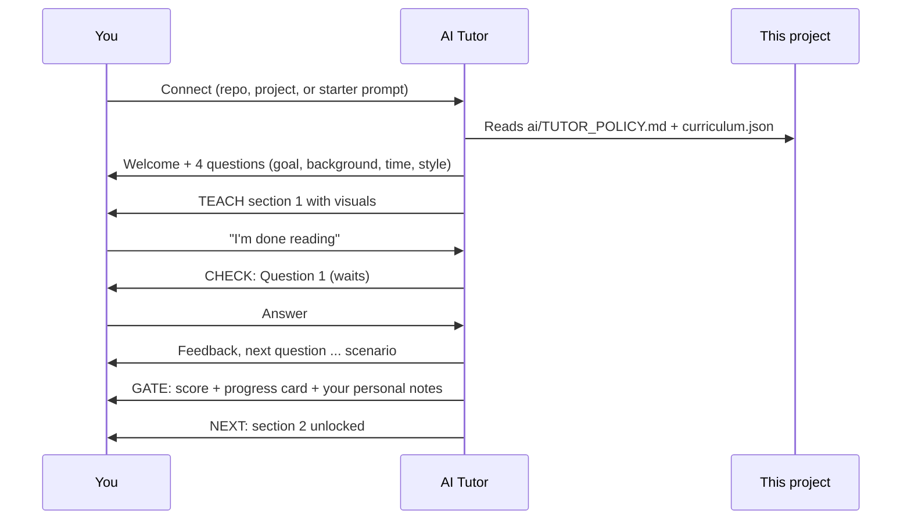

# Connect an AI Tutor to This Project

This repo is **AI-ready**. Connect any capable AI assistant and it becomes your personal SOC tutor: it asks you questions after each section, only moves on when you've answered, shares visuals and notes made for *you*, and publishes a progress card.

## How it works

## Pick your way to connect

| Your tool | How | Strength of the rules |
|---|---|---|
| **AI coding assistants that read repo files** (Claude Code, GitHub Copilot, Cursor, Codex-style agents) | Open the cloned repo. They auto-read `AGENTS.md`, `CLAUDE.md` or `.github/copilot-instructions.md`, which point to the policy | Strong. Rules load automatically |
| **Chat assistants with projects or custom instructions** (ChatGPT Projects, Claude Projects, Gemini Gems, etc.) | Upload the repo zip or key folders (`ai/`, `docs/`, `visuals/`) and paste `ai/TUTOR_POLICY.md` into the project instructions | Strong. Policy sits in the system prompt |
| **Any chat AI** | Paste the text from [starter-prompt.md](starter-prompt.md) and attach or link the docs | Good. Rules last for the chat |
| **No AI, just you** | Run `python scripts/checkpoint.py` | The script is your gate |

## What the learner gets

- A **personal path**: examples, pace and visuals tuned to your goal and background
- **Questions first**: the AI asks, you answer, then it moves on
- **Visuals and GIFs** from [visuals/](../visuals/) plus custom ones the AI makes
- **Notes for you** after every section ([learner/notes/](../learner/notes/))
- A **progress card** ([sample](../visuals/progress-card-sample.png)) and a final scorecard

## What this can and cannot do (said honestly)

- ✅ It makes skipping **inconvenient, visible and pointless**: the tutor refuses, the script keeps the gate closed, edits to your record show as **UNVERIFIED**, and your scorecard reflects the truth.
- ✅ It uses **the strongest mechanism each tool offers** (auto-loaded instruction files, project instructions).
- ⚠️ A repository of text files **cannot physically force** an AI tool to obey, and anyone can open any file. If you want a lock rather than a promise, the next step is a small hosted app that keeps answers on a server (see ROADMAP in the main README).
- ⚠️ AI tutors can make mistakes. For regulations, always confirm with the official sources in `docs/11-regulations-and-standards/sources.md`.

## For maintainers: adding questions

1. Edit `ai/_ai-only/questions.source.json` (answers and rationales live here).
2. Run `python scripts/build_question_bank.py` (writes the hashed learner-facing bank).
3. Run `python scripts/validate_repo.py`.
