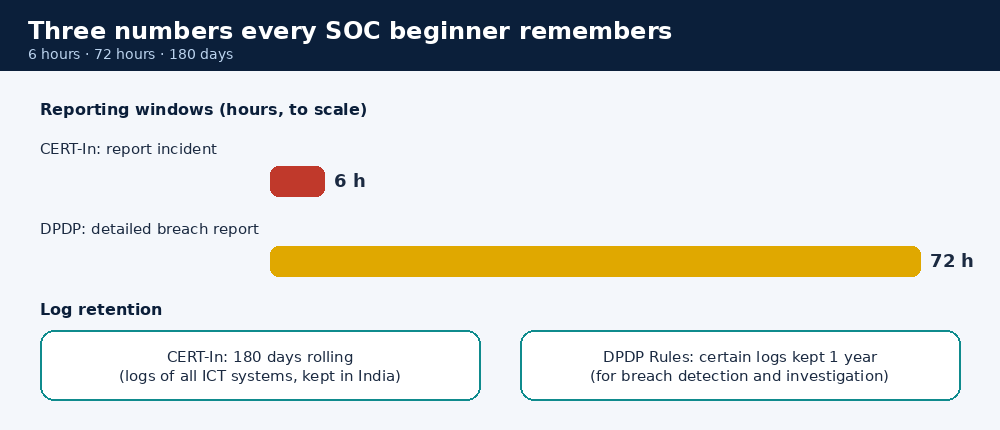
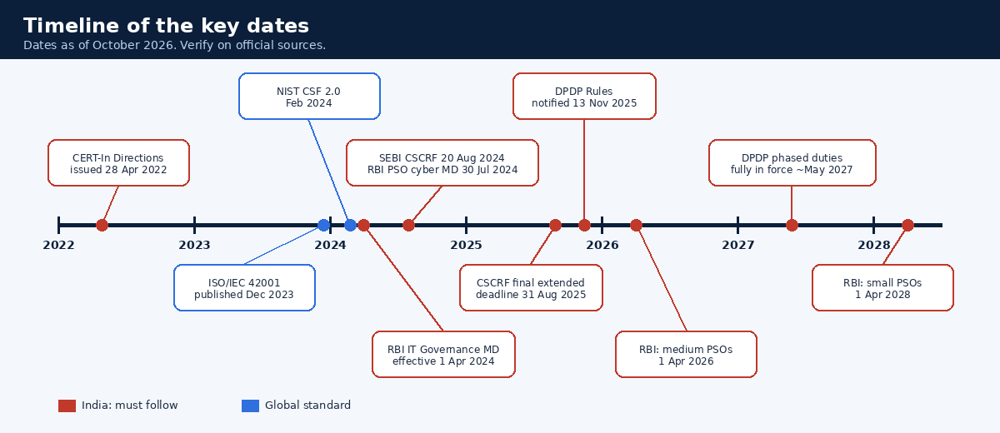

# Visual Library

AI tutors and learners can use these pictures straight away. They're generated by `scripts/make_visuals.py`, so they always match the guide.

| Visual | Use it to explain | File |
|---|---|---|
|  | How the Teach, Check, Gate, Next loop works | `visuals/tutor-gate.gif` |
|  | The life of an alert from arrival to lessons learned | `visuals/alert-lifecycle.gif` |
|  | The 7 stages of an attack and where to stop it | `visuals/kill-chain.gif` |
|  | The CERT-In 6-hour reporting clock | `visuals/cert-in-6-hour-clock.gif` |
|  | Indian laws vs global standards | `visuals/regulation-map.png` |
|  | 6 hours, 72 hours, 180 days | `visuals/reporting-clocks.png` |
|  | Key dates 2022-2028 | `visuals/regulation-timeline.png` |
|  | What a progress card looks like | `visuals/progress-card-sample.png` |

Interactive version: [site/index.html](../site/index.html) (kill chain stepper, alert-triage simulator, reporting-clock calculator).

## Section to visual map

| Section | Start with | Then make your own |
|---|---|---|
| Start Here | alert-lifecycle.gif | A "mall security vs SOC" comparison table |
| Networking | (none yet) | Mermaid diagram of a packet's journey; TCP handshake sequence diagram |
| Linux | (none yet) | Folder tree of `/var/log` with notes |
| Fundamentals | kill-chain.gif | Pyramid of Pain drawing; CIA triangle |
| Attacks | alert-lifecycle.gif | Flowchart of phishing response |
| Workflow | alert-lifecycle.gif | Severity decision tree |
| IOCs | (none yet) | Table of IOC types by tool |
| Tools | (none yet) | Diagram: SIEM + EDR + firewall logs into one timeline |
| Regulations | regulation-map.png, reporting-clocks.png, regulation-timeline.png, cert-in-6-hour-clock.gif | Learner's own "which rules apply to my company" flowchart |

## How an AI should create custom visuals (honestly)

1. **Mermaid** code blocks. GitHub and many chat apps render them.
2. **Tables and ASCII sketches.** Work everywhere.
3. **Animated SVG or interactive HTML**, if the tool supports artifacts, canvas or previews.
4. **GIFs**: show the ones above. Create a new one **only** if you can run code (adapt a function in `scripts/make_visuals.py`). Otherwise say: *"I can't generate a GIF here, so here's an animated alternative or the existing one."*
5. Never describe a visual you haven't actually produced as if it exists.
