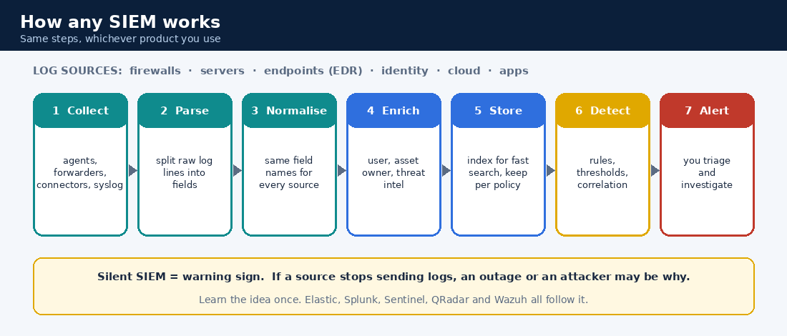
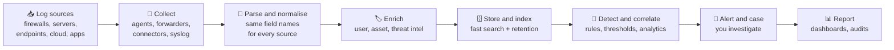

# 7. The Tools: SIEM, EDR and Log Analyzers

Three kinds of "eyes" work together. No single tool tells the full story.

| Layer | Question it answers | Examples (any one of many) |
|---|---|---|
| **SIEM** | "What's happening across everything?" | Elastic Security, Splunk, Microsoft Sentinel, IBM QRadar, Wazuh, Google SecOps |
| **EDR** | "What exactly happened on this laptop/server?" | SentinelOne, CrowdStrike Falcon, Microsoft Defender for Endpoint |
| **Log / event analyzers** | "What did the network devices see?" | ManageEngine EventLog Analyzer, FortiAnalyzer and similar |

> **Learn the idea, not the logo.** Every SIEM does the same job in the same order. Once you understand the job, switching products takes days, not months.

## 7.1 SIEM: the central brain (any product)

A **Security Information and Event Management** system collects logs from firewalls, servers, endpoints, apps, identity and cloud, makes them easy to compare, looks for suspicious patterns, and alerts you. It's also your **search engine for the past**: "show me everything this user did last Tuesday."





### The eight ideas every SIEM shares

| Idea | Plain meaning | Why you care |
|---|---|---|
| **Log source** | Anything that writes events | No logs, no visibility. First question in an investigation: "is the source even reporting?" |
| **Collection** | Agents, forwarders, connectors or syslog send logs in | A silent collector looks like a quiet network. It's dangerous |
| **Parsing** | Splitting a raw log line into fields (user, IP, action) | Bad parsing means rules silently miss things |
| **Normalisation** | Using the **same field names** for the same idea across all sources | One search ("failed logins") covers Windows, Linux and the firewall |
| **Enrichment** | Adding context: who owns this asset, is this IP known-bad? | Turns "an IP did something" into "a finance laptop talked to a known-bad server" |
| **Detection rules** | Logic that fires an alert: a threshold, a sequence, a match, an anomaly | Your queue is the output of these rules |
| **Tuning** | Adjusting rules to cut false positives without missing real attacks | Noisy rules cause alert fatigue |
| **Retention** | How long logs are kept, often hot (fast) then cold (cheap) | Investigations and audits need old logs. See [CERT-In 180 days](11-regulations-and-standards/indian-frameworks.md) |

### Same question, three products

*"Show failed logins from 203.0.113.45."* The idea is identical. Only the language changes. (Illustrative. Field names depend on how your data is set up.)

| Product | Query |
|---|---|
| Elastic (Kibana KQL) | `event.category : "authentication" and event.outcome : "failure" and source.ip : "203.0.113.45"` |
| Splunk (SPL) | `index=* tag=authentication action=failure src="203.0.113.45" \| stats count by user` |
| Microsoft Sentinel (Kusto KQL) | `SigninLogs \| where ResultType != "0" and IPAddress == "203.0.113.45" \| summarize count() by UserPrincipalName` |

> ⚠️ **Name clash:** "KQL" means *Kibana Query Language* in Elastic and *Kusto Query Language* in Microsoft's products. Different languages, same letters.

### Product cheat sheet: same concepts, different words

| Concept | Elastic Security (ELK) | Splunk | Microsoft Sentinel | IBM QRadar | Wazuh |
|---|---|---|---|---|---|
| Getting logs in | Beats / Elastic Agent, Logstash | Forwarders, HEC | Data connectors, agents | Event collectors | Wazuh agents |
| Where you search | Kibana (Discover) | Search app (SPL) | Logs (Kusto) | Log Activity | Dashboard / indexer |
| Detection logic | Detection rules | Correlation searches, alerts | Analytics rules | Rules | Rules and decoders |
| What you work on | Alerts, cases | Notable events | Incidents | Offenses | Alerts |
| Shared field naming | Elastic Common Schema (ECS) | Common Information Model (CIM) | ASIM | Normalised event properties | Rule/decoder fields |

Names and features change between versions, so treat this as a map and check each product's own documentation.

### Skills to build (in any SIEM)
- Searching by time range, user, host and IP
- Reading one normalised event and knowing each field
- Using a dashboard to spot spikes (failed logins, alert volume by severity)
- Pivoting from an alert to the raw logs and building a **timeline**
- Checking log-source health before trusting a quiet dashboard

> **Beginner tip:** learn to *read* dashboards accurately first. Misreading a chart causes missed attacks or false alarms.

### Elastic (ELK) as a worked example
Because it's free to try, the Elastic Stack is a popular first SIEM lab:

| Part | Job |
|---|---|
| **Elasticsearch** | Stores and indexes the data; the search engine |
| **Logstash** | Receives, cleans and reshapes logs before storing |
| **Kibana** | The screen you use: search, dashboards, alerts |
| **Beats / Elastic Agent** | Small shippers that send logs from machines into the stack |

Every box in the pipeline diagram above has a matching part here. Do the same exercise for whichever SIEM you meet at work.

> **Next steps:** which fields matter per log source, starter detection ideas and the dashboards every SOC needs are in [Detection engineering and hunting](14-detection-engineering-and-hunting.md). Windows events are explained in depth in [Windows and Active Directory](12-windows-and-active-directory.md).

### Windows event IDs worth knowing
| ID | Meaning |
|---|---|
| 4624 / 4625 | Successful / failed logon |
| 4688 | New process created |
| 4672 | Special privileges assigned |
| 4720 | User account created |
| 4732 | Member added to a local group |
| 1102 | Audit log cleared (suspicious) |

Sysmon (a free Microsoft tool) adds richer endpoint logs: process creation (ID 1), network connection (3), file creation (11), and more.

## 7.2 EDR: eyes on the endpoint

An **Endpoint Detection and Response** agent runs on each laptop/server. It records processes, files, registry changes and network connections, and can **respond** directly.

| Capability | Plain meaning |
|---|---|
| Behavioral detection | Flags suspicious *behavior*, not just known files |
| Process tree / storyline | Shows what started what: "Word → PowerShell → unknown exe" |
| **Host isolation** | Cuts the machine off from the network but keeps the EDR link so you can still work on it |
| Kill / quarantine | Stop a process, move a file to safe storage |
| Rollback (some products) | Undo file changes made by ransomware |
| Threat hunting | Search recent history across all endpoints for an IOC or behavior |

SentinelOne and CrowdStrike are both cloud-managed EDR platforms. Their screens differ, but the workflow is the same: open the alert → read the timeline → decide containment → document → escalate if needed.

## 7.3 Log / event analyzers

These collect logs from network and infrastructure devices (firewalls, routers, switches, domain controllers) for reporting, compliance and investigation.

- **FortiAnalyzer**: central logging and reporting for Fortinet firewalls (traffic, threat, events)
- **ManageEngine EventLog Analyzer**: log management, compliance reports, Active Directory auditing
- Similar tools exist from many vendors

Use them to answer: "Did the firewall allow or block that connection? How much data went out?"

## 7.4 How the three work together

```
SIEM alert (many sources correlated)
     │
     ├─► EDR: what did the endpoint actually do? (process tree, files)
     │
     ├─► Log analyzer / firewall: what did the network see? (allowed/blocked, volume)
     │
     └─► Threat intel: is this IP/domain/hash known-bad?
                │
                ▼
      Build ONE timeline → decide → act → document
```

## 7.5 Alerts that deserve context
Enrich every alert with asset owner, user role, and threat-intel reputation before acting. It cuts false positives dramatically.

## ✅ After this page you should be able to
- Describe the SIEM pipeline from log source to alert in your own words
- Explain parsing, normalisation, enrichment and tuning to a friend
- Say why a *quiet* SIEM can be a warning sign
- Explain what EDR sees that a SIEM can't, and when you'd use host isolation
- Describe an investigation that uses SIEM, EDR and a log analyzer together
