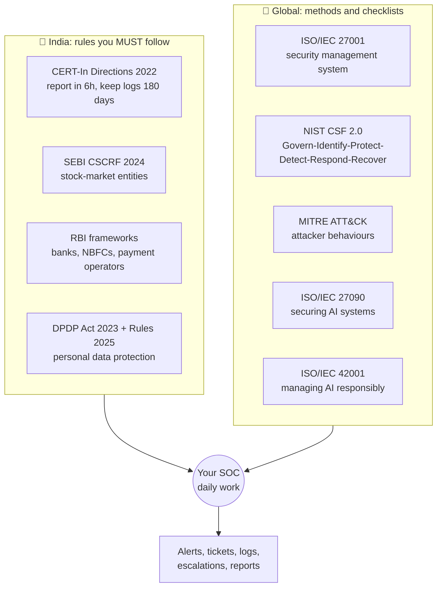
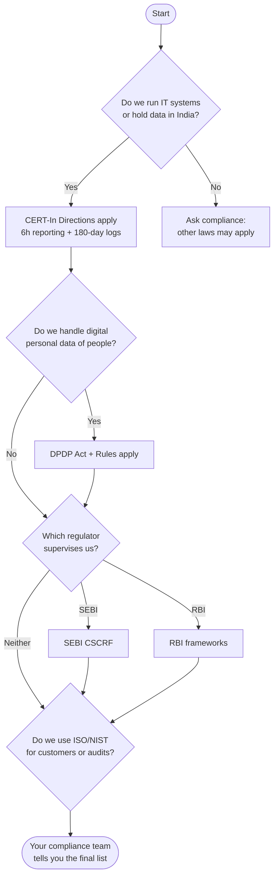

# 11. Rules of the Road: Regulations and Standards for SOC Beginners

> **Last verified:** 22 October 2026. Laws and frameworks change. Always confirm with your company's compliance team and the official sources in [sources.md](sources.md).
> **This is education, not legal advice.**

## Why should a SOC beginner care?

Think of driving. There are **traffic laws** (you *must* follow them or get fined) and there are **good-driving guides** (not law, but they make you safer, and your employer may insist on them).

Cybersecurity has the same two things:

| | What it is | Everyday example | In this guide |
|---|---|---|---|
| **Regulation / law** | A rule you **must** follow. Breaking it can mean penalties | Speed limit | CERT-In Directions, SEBI CSCRF, RBI directions, DPDP Act |
| **Standard / framework** | A recognised method or checklist you **choose** (or a customer or regulator asks you) to follow | A defensive-driving course | ISO/IEC 27001, NIST CSF, MITRE ATT&CK, ISO/IEC 27090, ISO/IEC 42001 |

**Why does a SOC analyst need this?** Because your daily actions, like noticing an alert, writing down the time, and keeping logs, feed directly into legal clocks. When an incident is serious, the *minutes you saved or lost* at L1 can decide whether your company meets a deadline.

## The three numbers to remember

| Number | Meaning | Where it comes from |
|---|---|---|
| ⏱️ **6 hours** | Report certain cyber incidents to CERT-In within 6 hours of noticing them | CERT-In Directions (2022) |
| 🗂️ **180 days** | Keep logs of your IT systems for a rolling 180 days (within India) | CERT-In Directions (2022) |
| ⏱️ **72 hours** | Send a detailed personal-data-breach report to the Data Protection Board within 72 hours of becoming aware | DPDP Rules (2025) |

## The big picture

## Which rules apply to my company?

Not every rule applies to every company. A rough guide:

**Always ask your manager or compliance team, "Which of these apply to us?"** That is a smart question to ask in week one.

## Pages in this guide

1. [Indian frameworks](indian-frameworks.md): CERT-In, SEBI CSCRF, RBI, DPDP
2. [International standards](international-standards.md): ISO 27001, NIST CSF, MITRE ATT&CK, ISO 27090, ISO 42001
3. [What this means for an Intern / L1](what-it-means-for-l1.md): your part in the clock
4. [Sources](sources.md)

🎞️ Animated explainers: [CERT-In 6-hour clock](../../visuals/cert-in-6-hour-clock.gif) · [Interactive visual lab](../../site/index.html)

## ✅ After this section you should be able to
- Explain the difference between a law and a framework in one sentence
- Recall the numbers 6 hours, 180 days and 72 hours and say what each is for
- Name the four Indian frameworks and who they mainly apply to
- Say why an analyst's timestamps matter
