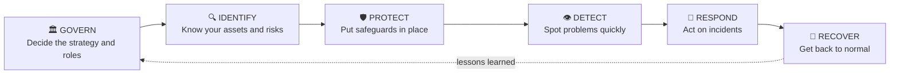

# International Standards, Explained Simply

These are not Indian laws. They are **world-recognised methods**. Companies adopt them to build good security, win customer trust and pass audits. Several Indian rules (like SEBI's CSCRF) borrow ideas from them.

---

## 5. ISO/IEC 27001: the "security management system" standard

**In one line:** A recipe for running information security as an ongoing management process, not a one-time project.

**Analogy:** Running a restaurant kitchen. You don't just cook one safe meal; you set up hygiene rules, train staff, inspect, fix problems and repeat.

| Point | Detail |
|---|---|
| What it asks for | An **ISMS** (Information Security Management System): find risks, pick controls, run them, check them, improve them (Plan → Do → Check → Act) |
| Current edition | ISO/IEC 27001:**2022** |
| Controls list | Annex A has **93 controls** in four themes: Organisational, People, Physical, Technological |
| Companion | **ISO/IEC 27002** explains each control in detail |
| Certifiable? | **Yes.** An outside auditor can certify a company |
| SOC link | Monitoring, logging, incident management and evidence all sit under it |

**Remember it as:** *"The kitchen rulebook."*

---

## 6. NIST Cybersecurity Framework (CSF)

**In one line:** A simple six-part way to talk about cybersecurity, from the US standards body NIST.

**Heads-up:** Many older guides (and the table that inspired this page) list **five** functions: Identify, Protect, Detect, Respond, Recover. **CSF 2.0 (February 2024)** added a sixth, **Govern**.

| Function | House analogy | SOC example |
|---|---|---|
| Govern | The family agrees who is responsible for what | Escalation matrix, policies |
| Identify | List of everything valuable in the house | Asset inventory |
| Protect | Locks, alarms, window bars | Firewalls, MFA, patching |
| **Detect** | Cameras and motion sensors | **SIEM, EDR, alerts, your L1 work** |
| **Respond** | Calling the police and locking down | **Containment, escalation, notifying** |
| Recover | Repairs and insurance | Backups, restore, lessons learned |

**Certifiable?** No. It is a framework you use and measure yourself against.

**Remember it as:** *"The six-room house of security."*

---

## 7. MITRE ATT&CK (Enterprise)

**In one line:** A free, public encyclopedia of how real attackers behave.

**Analogy:** A football team's scouting book on the opposition. "They always attack down the left side." Except here, it is "they often send a phishing email, then use PowerShell, then steal passwords."

| Point | Detail |
|---|---|
| Structure | A matrix of **Tactics** (the goal) and **Techniques** (the method) |
| Enterprise tactics | 14, from Reconnaissance through to Impact |
| IDs | Techniques have codes like **T1059** (Command and Scripting Interpreter) |
| SOC link | Tag alerts with ATT&CK IDs; check which attacker behaviours your detections cover and which they miss |

**The 14 Enterprise tactics in order:** Reconnaissance → Resource Development → Initial Access → Execution → Persistence → Privilege Escalation → Defense Evasion → Credential Access → Discovery → Lateral Movement → Collection → Command and Control → Exfiltration → Impact.

**Certifiable?** No. It is a knowledge base.

**Remember it as:** *"The attacker's playbook, published."*

---

## 8. ISO/IEC 27090: securing AI systems

**In one line:** Guidance on the security threats that are *special to AI*.

> ⚠️ **Status note.** This standard has been in the final stages of publication around 2026. Check ISO.org for its current status and exact title.

**Why AI needs its own guidance:** AI systems can be attacked in ways normal software can't.

| AI-specific attack | Plain-English meaning |
|---|---|
| **Data poisoning** | Feeding bad examples into training data so the AI learns the wrong thing |
| **Evasion / adversarial inputs** | Tricking the AI with specially crafted inputs so it gets things wrong |
| **Model theft** | Copying or extracting someone's trained model |
| **Model inversion / membership inference** | Making the AI leak details about the private data it was trained on |
| **Prompt injection** | Sneaking hidden instructions into text so an AI assistant does something it shouldn't |

**How it fits:** It *adds to* ISO 27001/27002; it doesn't replace them. It is guidance, not a certificate you hang on the wall.

**SOC link:** Your SOC may soon need to watch AI tools too: unusual use of AI chat tools, data being pasted into unapproved AI services, odd behaviour from internal AI assistants.

**Remember it as:** *"Security rules for the robot brain."*

---

## 9. ISO/IEC 42001:2023: managing AI responsibly

**In one line:** The world's first certifiable **AI Management System** standard.

**Analogy:** If ISO 27001 is the kitchen rulebook for security, ISO 42001 is the rulebook for *using AI responsibly* in the kitchen: who may use the smart oven, how we check its decisions, what we do when it makes a mistake.

| Point | Detail |
|---|---|
| Published | December 2023 |
| What it asks for | Policies, roles, risk checks, impact assessments, monitoring and improvement for AI systems |
| Certifiable? | **Yes** |
| Pairs with | ISO 27001 (security) and ISO 27090 (AI threats) |
| SOC link | Records of AI use, incidents involving AI systems, and evidence that AI tools used in the SOC are controlled |

**Remember it as:** *"The AI governance rulebook."*

---

## Side-by-side

| Standard | Is it certifiable? | Best described as | Beginner takeaway |
|---|---|---|---|
| ISO/IEC 27001 | ✅ Yes | Management system | Security is a continuous process |
| NIST CSF 2.0 | ❌ No | Framework | Govern → Identify → Protect → **Detect → Respond** → Recover |
| MITRE ATT&CK | ❌ No | Knowledge base | Speak the attacker's language |
| ISO/IEC 27090 | ❌ Guidance | AI threat guidance | AI has its own attacks |
| ISO/IEC 42001 | ✅ Yes | AI management system | Use AI with rules and oversight |

## Also worth knowing (to explore later)
ISO/IEC 27002 (control guidance), NIST SP 800-61 (incident handling), NIST AI Risk Management Framework, PCI DSS (card payments), CIS Controls.
