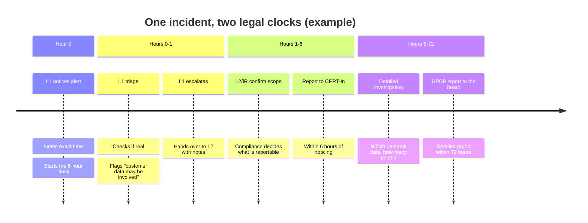

# What This Means for an Intern or L1 Analyst

You don't need to memorise legal text. You need **five habits** that keep your company on the right side of the clocks.

## The five habits

| # | Habit | Why |
|---|---|---|
| 1 | **Write the time you noticed**, in your ticket, to the minute, with the time zone | CERT-In's 6 hours runs from noticing (or being told) |
| 2 | **Say "personal data may be involved"** when it might be | It can start the DPDP 72-hour process |
| 3 | **Escalate early.** Don't sit on a possible reportable incident | Reports are filed by designated people, but they need time to prepare |
| 4 | **Never delete or shorten logs.** Preserve evidence | Logs must be kept for 180 days (CERT-In), and are the proof in an audit |
| 5 | **Use consistent time sources** and note when systems' clocks look wrong | Timelines from different tools must line up |

## A worked example: the two clocks

## Who does what?

| Task | Usually done by |
|---|---|
| Noticing and first triage, recording the time | **You (L1)** |
| Confirming it is real and its scope | L2 / Incident Response |
| Deciding whether it must be reported, and filing | Compliance / CISO / designated point of contact |
| Telling affected people and the Data Protection Board | Data Protection Officer / Legal / Management |
| Keeping logs available | IT and SOC engineering, with your help |

Your company defines the exact process. **Learn yours in week one.**

## Three mini-scenarios

**1. A phishing mail steals a password. The attacker reads a mailbox that holds customer names and phone numbers.**
Possible reportable incident (phishing / unauthorised access) *and* a personal data breach. Your job: record the time, preserve the mail and logs, escalate and mention "customer personal data may be exposed".

**2. A server is quietly sending large files to an unknown address.**
Possible data leak. Don't power it off. Isolate it if you are authorised. Note the time you noticed. Escalate as potentially reportable.

**3. An internal AI assistant starts showing other users' private documents after someone pasted a hidden instruction into a file.**
An AI-related incident (think prompt injection). Capture the evidence (prompt, output, time, user) and escalate. It may also involve personal data.

## What auditors love to see in your tickets
- Exact timestamps
- What was checked and what was found (facts only)
- What action was taken and by whom
- Who was told, and when
- Where the evidence is stored

## ✅ After this page you should be able to
- Name the five habits and give one reason for each
- Explain how a single incident can start two clocks
- Say which parts of the process you own and which belong to compliance
