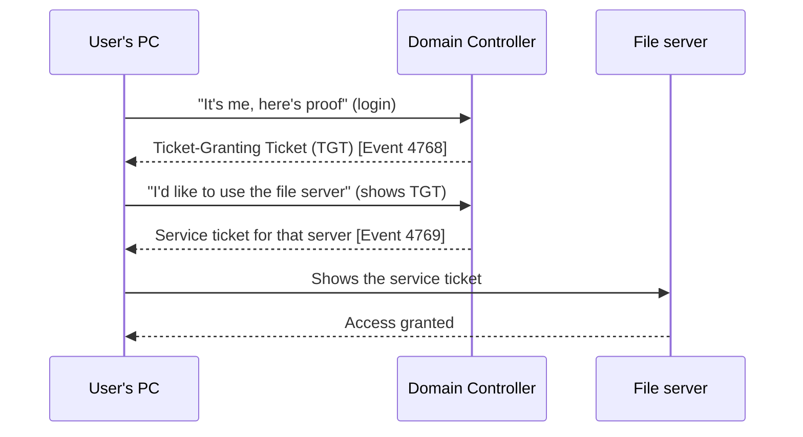

# 12. Windows and Active Directory for Analysts

Most company laptops and many servers run **Windows**, and most companies manage their people and computers with **Active Directory (AD)**. So many alerts you see will be about Windows logins, processes and accounts.

## 12.1 The cast of characters

| Term | Plain meaning |
|---|---|
| **Active Directory (AD)** | The company's phone book *and* door-lock system: who exists, which groups they belong to, what they may access |
| **Domain controller (DC)** | The server that holds AD and checks logins. Extremely valuable to attackers |
| **User / service account** | A person's account vs an account used by software. Service accounts often have powerful, rarely changed passwords |
| **Group** | A bundle of permissions. "Domain Admins" is the most powerful. Changes to it deserve attention |
| **Group Policy (GPO)** | Rules pushed to many computers at once (password rules, what's allowed to run) |
| **Kerberos / NTLM** | The two main ways Windows proves who you are on a network. Kerberos is newer; NTLM is older and weaker |
| **Privilege** | A special right, like debugging programs or backing up files |

## 12.2 How a Kerberos login works (in one picture)

Think of a concert: the TGT is your wristband, and each service ticket is a pass for one stage.

## 12.3 Logon types (the "how did they log in?" clue)

| Type | Name | Meaning |
|---|---|---|
| 2 | Interactive | Someone at the keyboard |
| 3 | Network | Connecting to a share or service over the network |
| 4 | Batch | A scheduled task |
| 5 | Service | A service starting |
| 7 | Unlock | Screen unlocked |
| 9 | NewCredentials | Using different credentials for network access ("run as") |
| 10 | RemoteInteractive | **Remote Desktop (RDP)** |
| 11 | CachedInteractive | Logged in with cached credentials (offline) |

A **type 10** login to a server from a laptop in HR is a question worth asking.

## 12.4 Event IDs worth memorising

| Event ID | Meaning | Why you care |
|---|---|---|
| 4624 / 4625 | Logon success / failure | Brute force, odd times, odd places |
| 4648 | Logon using explicit credentials | Lateral movement, "run as" |
| 4672 | Special privileges assigned to a new logon | Admin-level logins |
| 4688 | New process created (needs auditing on) | What ran, and who started it |
| 4720 | User account created | Backdoor accounts |
| 4728 / 4732 / 4756 | Member added to a global / local / universal security group | Privilege escalation |
| 4740 | Account locked out | Password guessing |
| 4768 / 4769 | Kerberos TGT / service ticket requested | Ticket abuse |
| 4776 | NTLM credentials checked | Older-protocol logins |
| 4698 | Scheduled task created | Persistence |
| 4697 / 7045 | Service installed | Persistence, malware |
| 4719 | Audit policy changed | Attacker hiding tracks |
| **1102** | **Audit log cleared** | Almost always worth escalating |
| 4104 | PowerShell script block logged (PowerShell log) | See what scripts actually ran |

**Sysmon** (a free Microsoft tool) adds far more detail: process creation with full command line (ID 1), network connections (3), file creation (11), registry changes (12-14) and more. Many SOCs depend on it.

## 12.5 Active Directory attacks in plain English

| Attack | What the attacker does | What you might notice |
|---|---|---|
| **Password spraying** | Tries one common password on *many* accounts, staying under lockout limits | Failures across many users from one source |
| **Pass-the-hash** | Steals a password *hash* from memory and uses it as if it were the password. No cracking needed | Network logons (type 3) with NTLM from unusual machines, one account on many hosts |
| **Kerberoasting** | Asks AD for service tickets for service accounts, then cracks them offline to learn the passwords | Many service-ticket requests (4769) from one user in a short time, often with older encryption |
| **DCSync** | Pretends to be a domain controller and asks others to "replicate" password data | Directory replication requests from a machine that isn't a DC |
| **Credential dumping** | Reads passwords or hashes from memory or disk | Suspicious access to the security process, known dumping tools in EDR |

You are not expected to detect all of these on day one. You **are** expected to recognise the words in an alert and escalate sensibly.

## 12.6 What an analyst checks first on a suspicious Windows host

1. Who logged in, how (logon type), from where, and when?
2. What processes ran, and what started them (parent-child)?
3. Any new accounts, group changes, scheduled tasks or services?
4. Was the audit log cleared or a security tool stopped?
5. Any outbound connections right after?

## ✅ After this page you should be able to
- Explain AD, a domain controller and a GPO in one sentence each
- Read a logon type and say what it implies (especially 3 and 10)
- Name 8 event IDs and what they mean
- Describe pass-the-hash, Kerberoasting and DCSync simply
- List five first checks on a suspicious Windows machine
