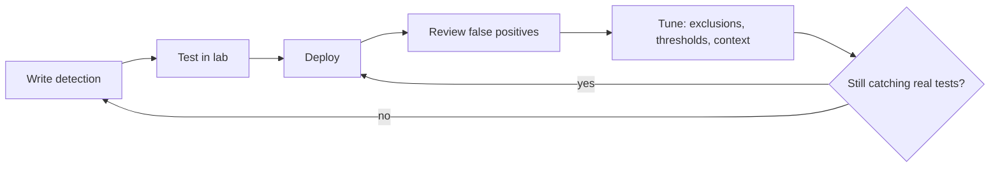

# 14. Detection Engineering and Threat Hunting

Alerts don't appear by magic. Someone wrote the logic that produces them. This page shows how detections are built, tested and improved, and how analysts go looking for attackers that no alert has caught yet.

## 14.1 Kinds of detection

| Type | Idea | Example |
|---|---|---|
| **Match (IOC / signature)** | Known-bad thing seen | A file hash or IP on a threat list |
| **Threshold** | Too much of something | 20 failed logins in 5 minutes |
| **Sequence / correlation** | Related events in order | Many failures, then a success, then a new admin account |
| **Anomaly / behaviour** | Different from normal | A user downloads 50 times their usual amount |

Stronger detections lean toward behaviour. Remember the [Pyramid of Pain](03-security-fundamentals.md).

## 14.2 Anatomy of a good detection

| Part | Question it answers |
|---|---|
| Name | What is this? |
| **ATT&CK mapping** | Which attacker behaviour does it cover? |
| Data source | Which logs does it need? Are they actually arriving? |
| Logic | What exactly triggers it? |
| Severity | How bad if true? |
| False-positive notes | What harmless things look like this? |
| Response steps | What should the analyst do first? |
| Owner and review date | Who keeps it healthy? |

## 14.3 Portable rule formats
- **Sigma**: an open, product-neutral way to write log-based detections that can be translated to many SIEMs. Write once, convert for your tool.
- **YARA**: pattern rules for **files** and memory, used in malware work.
- **STIX / TAXII**: standard formats and transport for sharing threat intelligence.

## 14.4 Starter detection use cases

Product-neutral logic you can implement in any SIEM:

| Use case | Logic in plain words | Typical severity |
|---|---|---|
| Burst of failed logins | N failures for one account or from one source in M minutes | Medium |
| Success after failures | A success from the same source right after many failures | High |
| Off-hours privileged login | Admin account logs in outside normal hours or from a new place | High |
| New local admin / group change | User added to a privileged group | High |
| Port scan | One source touches many ports or hosts in a short window | Low-Medium |
| Large outbound transfer | Bytes out far above that host's normal | Medium-High |
| Log cleared / security tool stopped | Audit log cleared, EDR service stopped | High |
| Impossible travel | Same user, two far-apart places, too little time | Medium-High |

## 14.5 Dashboards every SOC needs
Alerts by severity and status over time · Top sources of failed logins · Privileged account activity · Logins by country or new location · Endpoint detections by tactic · Firewall allow/block trends · Threat-intelligence matches · Vulnerabilities by severity · Cloud configuration findings · **Log-source health** (who has gone quiet?)

## 14.6 Which fields matter per log source

Field **names differ** between products and setups, but the ideas are the same:

| Log source | The fields you'll want |
|---|---|
| Windows / Linux logins | user, event or action, host, source address, logon type, outcome |
| Endpoint security (EDR) | alert name, ATT&CK tactic/technique, severity, process, host |
| Firewall / IDS | source IP, destination IP and port, action (allowed/blocked), rule |
| Security alerts | severity, tactic, risk score, status |
| Threat intelligence | indicator type, indicator value, source, first/last seen, confidence |
| Cloud | provider, account, event type, resource, actor |
| Vulnerability scanner | CVE ID, CVSS score, patch status, host |

## 14.7 Test your detections safely (in a lab only)
- **Atomic Red Team**-style tests: tiny, safe actions mapped to ATT&CK techniques that should fire your detection.
- **Adversary emulation** tools (for example MITRE Caldera) run planned attack chains.
- **ATT&CK Navigator** shows a colour map of which techniques you cover.
- **Purple teaming:** attackers (red) and defenders (blue) work together to improve coverage.

If a test doesn't fire your detection, that's a **gap found**, not a failure. Log it, fix it, retest.

## 14.8 The tuning loop

## 14.9 Threat hunting

**Detection waits for alerts. Hunting goes looking.**

1. **Hypothesis:** "If an attacker used scheduled tasks to persist here, I'd see task creations from non-admin accounts."
2. **Data:** pick the logs that would show it.
3. **Search and analyse:** query, filter, look for oddities.
4. **Findings:** benign, suspicious or malicious? Escalate if needed.
5. **Improve:** turn the hunt into a permanent detection, or fix the log gap you discovered.
6. **Document** the hypothesis, data, result and follow-ups.

Good hunts start from ATT&CK ("how might *this* technique appear in *our* logs?").

## ✅ After this page you should be able to
- Name four detection types and give an example of each
- List the parts of a good detection
- Describe Sigma and YARA in one line each
- Sketch an "off-hours privileged login" detection (source, logic, severity, false positives, response)
- Walk through a hypothesis-driven hunt
