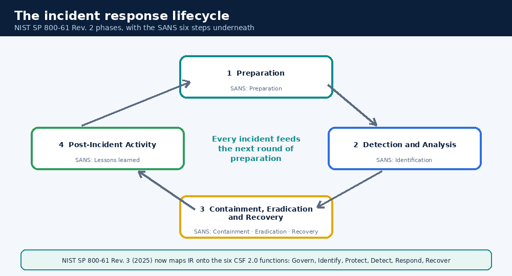

# 15. Incident Response and Reporting

An **incident** is a security event that has (or may have) harmed the organisation. **Incident response (IR)** is how a team handles it calmly and in order.

## 15.1 Two well-known ways to describe the lifecycle



| NIST SP 800-61 **Rev. 2** (2012, still widely taught) | SANS six steps | What it means in plain words |
|---|---|---|
| 1. Preparation | 1. Preparation | Tools, people, playbooks, contacts ready *before* trouble |
| 2. Detection and Analysis | 2. Identification | Spot it, confirm it, work out scope and severity |
| 3. Containment, Eradication and Recovery | 3. Containment · 4. Eradication · 5. Recovery | Stop the spread, remove the cause, restore normal |
| 4. Post-Incident Activity | 6. Lessons Learned | Review, document, improve |

> **Update:** in April 2025 NIST finalised **SP 800-61 Rev. 3**, which replaces Rev. 2. It treats incident response as part of everyday cybersecurity risk management and organises its advice around the six functions of **NIST CSF 2.0** (Govern, Identify, Protect, Detect, Respond, Recover) instead of four phases. The four-phase model above is still the easiest way to *learn* the flow, and you'll hear it in interviews. Check the latest NIST publication for the current wording.

## 15.2 What each stage looks like for an L1

| Stage | What you do |
|---|---|
| Preparation | Know the playbooks, escalation matrix and contacts. Check your tools work |
| Identification | Triage, enrich, confirm, set severity, **write the time you noticed** |
| Containment | Short-term: isolate the host, disable an account, block an IP (within your authority). Long-term fixes follow |
| Eradication | Remove malware, close the hole, reset credentials, patch (usually L2/IR leads) |
| Recovery | Restore from clean backups, monitor closely for return |
| Lessons learned | Take part in a **blameless** review. Fix process, not people |

### Evidence basics
- Preserve first, fix second. Don't delete or "tidy up".
- Note **who** collected **what**, **when** and **where it's stored** (chain of custody).
- Record times in one time zone (UTC is common) and note the source clock.
- Take copies of volatile data (running processes, connections) before changing the system, if you are authorised.

## 15.3 An incident report template

```
TITLE:        <short, factual>
STATUS:       <open / contained / closed>   SEVERITY: <level>
SUMMARY:      <3 sentences: what happened, impact, current state>
TIMELINE (UTC):
  hh:mm  detected by <source>
  hh:mm  triaged by <name>, found <fact>
  hh:mm  host isolated / account disabled / IP blocked
SCOPE:        <systems, users, data affected; how we know>
INDICATORS:   <IOCs, defanged>
ROOT CAUSE:   <how they got in, or "under investigation">
ACTIONS TAKEN:<what, who, when>
IMPACT:       <business and data impact; personal data involved? yes/no/unknown>
NEXT STEPS:   <owner and due date for each>
LESSONS:      <what to change in detection, process, training>
```

## 15.4 Explaining an incident to a non-technical manager

Use **S-I-A-N**: **S**ituation, **I**mpact, **A**ction, **N**ext.

> *Situation:* "A staff laptop in Finance was infected with malware this morning.
> *Impact:* One laptop is affected. We have no sign yet of customer data being touched.
> *Action:* We isolated it from the network within 10 minutes and reset the user's password.
> *Next:* We're checking five other machines for the same signs and will update you at 3 PM."

Rules: lead with what matters to them, skip jargon, say what you **don't yet know**, and give a time for the next update. Never guess.

## ✅ After this page you should be able to
- Describe both lifecycle models and map one to the other
- Say what changed in NIST SP 800-61 Rev. 3
- Fill in an incident report template
- Explain an incident to a manager in four sentences
