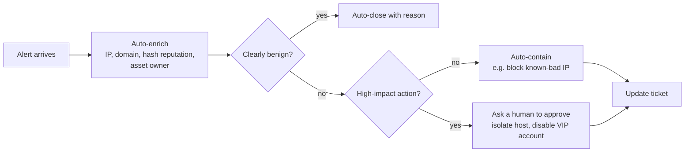

# 16. SOAR, Ticketing and Investigation Tools

## 16.1 SOAR: automation with guard-rails

**SOAR** (Security Orchestration, Automation and Response) software runs **playbooks**, step-by-step workflows, so analysts don't repeat boring tasks.

**Good automations:** enrich indicators · open and update tickets · remove a confirmed phishing email from all mailboxes · block known-bad IPs · notify the owner.

**Guard-rails that matter**
- **Human approval** before high-impact actions (isolating a server, disabling an executive's account)
- **Allow-lists** so you never auto-block a critical partner, your own scanner or a cloud provider
- **Rollback**: every block should be easy to undo
- **Logging**: every automated action recorded and reviewable
- **Test first** in a safe environment

Open-source and commercial SOAR tools exist. The concepts are the same.

## 16.2 Ticketing

Every alert and incident lives in a **ticket**: a record of who did what and when. Examples of platforms: ServiceNow, Jira Service Management, TheHive (open-source IR platform).

| Ticket field | Why it matters |
|---|---|
| Severity and status | Prioritisation and SLAs |
| Timeline of actions | Proof and handover |
| Evidence links | Anyone can re-check your work |
| Verdict and reason | Needed for audits and tuning |
| Owner and next step | No ticket is ever "nobody's problem" |

See the note template in [Alert handling workflow](05-alert-handling-workflow.md).

## 16.3 The investigation toolkit

| Need | What it does | Examples |
|---|---|---|
| **Reputation lookup** | Is this IP, domain or hash known-bad? | VirusTotal, AbuseIPDB |
| **OSINT** | What is this IP or domain? Who owns it? What's exposed? | WHOIS, Shodan |
| **Decoding** | Un-scramble encoded text (Base64, hex...) | CyberChef |
| **Sandbox** | Run a suspicious file or URL safely and watch what it does | ANY.RUN, Hybrid Analysis, self-hosted Cuckoo-style sandboxes |
| **Threat intel platform** | Store and share indicators and reports | MISP, OpenCTI, AlienVault OTX |
| **Memory and file analysis** | Look inside memory dumps and binaries | Volatility, REMnux |

> ⚠️ **Don't upload company secrets to public services.** Many online scanners and sandboxes **share submissions** with their community or customers. Never upload confidential documents, internal URLs or customer data. Use your company's approved, private tools, or look up only a **hash or an indicator**, not the file. If in doubt, ask your lead first.

## 16.4 Malware analysis basics

| Approach | What you do | Safe? |
|---|---|---|
| **Static** | Look *without running*: file hash, strings, metadata, imports | Safer, but can't see runtime behaviour |
| **Dynamic** | Run it in a sandbox and watch processes, files, registry, network | Only inside an isolated lab or sandbox |

Output you want: hashes, domains and IPs contacted, files and registry keys created, persistence method, and a list of IOCs to block and hunt for. Beginners rarely do deep reverse engineering. You will often read someone else's sandbox report, so learn to extract the IOCs.

## 16.5 Threat intelligence in a sentence
Collect → process → analyse → share. **Tactical** intel (indicators) helps today's alerts, **operational** intel (campaigns) helps hunts, **strategic** intel (trends) helps leaders plan. Judge every feed on **quality** (is it accurate and fresh?), not quantity.

## ✅ After this page you should be able to
- Draw a simple SOAR playbook with a human-approval step
- Explain three guard-rails for automation
- Match five tools to five investigation needs
- Say why you should not upload confidential files to public sandboxes
- Compare static and dynamic malware analysis
