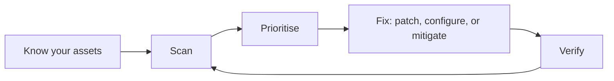

# 17. Cloud Security, UEBA and Vulnerability Management

## 17.1 Cloud security basics

### Shared responsibility
The cloud provider secures **the cloud itself** (buildings, hardware, core services). **You** secure what you put in it: identities, configuration, data, applications.

```
 Provider:  data centres · hardware · core service platform
 You:       who can log in · what's public · how it's configured · your data · your apps
```

### Cloud logs: the "control plane"
Cloud activity is recorded as **who did what to which resource**. Each provider has its own audit log (for example AWS CloudTrail, Microsoft Entra ID and Azure activity logs, Google Cloud Audit Logs). They are the cloud version of a Windows security log.

### Common cloud incidents
| Problem | Why it hurts |
|---|---|
| Storage bucket made public | Data exposed to the internet |
| Over-powerful roles or users | One stolen account can do everything |
| Leaked access keys (for example in public code) | Attackers use them within minutes |
| Account without MFA | Easy takeover |
| New access keys or admin roles created unexpectedly | Possible persistence |
| Security group opened to the whole internet | Direct attack path |
| Mass data download or export | Possible exfiltration |

**Identity is the new perimeter.** In the cloud, most attacks start with a login.

Native detection services exist (for example AWS GuardDuty, Microsoft Defender for Cloud, Google Security Command Center). They feed alerts into your SIEM.

## 17.2 UEBA: learning what "normal" looks like

**User and Entity Behaviour Analytics** learns each user's and device's normal habits (hours, locations, data volume, systems used) and scores unusual behaviour.

| Normal for Priya | Unusual |
|---|---|
| 9-6 login from Pune | A 3 AM login from another country |
| ~200 MB of downloads a day | 20 GB in an hour |
| Uses 5 apps | Suddenly touches 50 servers |

UEBA is great at **insider threats and stolen accounts**, but it needs good data and tuning, and it raises "unusual" not "malicious". You still judge.

## 17.3 Vulnerability management

A **vulnerability** is a weakness. **Vulnerability management** is the repeating cycle of finding, ranking and fixing them.



### How bad is it? CVSS
| Score | Severity |
|---|---|
| 0.1 – 3.9 | Low |
| 4.0 – 6.9 | Medium |
| 7.0 – 8.9 | High |
| 9.0 – 10.0 | **Critical** |

CVSS says how severe a flaw *could be*. Also ask:
- **Is it being exploited now?** (for example the public CISA Known Exploited Vulnerabilities list)
- **How likely is exploitation?** (scores like EPSS estimate it)
- **Is the asset internet-facing or holding sensitive data?**

A "High" on an exposed, exploited system beats a "Critical" on an isolated lab box.

### Where the SOC fits
- You see **exploit attempts** against unpatched systems in IDS, firewall and web logs.
- When a big new vulnerability is announced, the SOC checks: *Do we run it? Is it exposed? Are we seeing exploit attempts? Is there a patch or workaround?*
- Patch deadlines (SLAs) are set by each organisation.

## ✅ After this page you should be able to
- Explain the shared responsibility model
- Name six common cloud misconfigurations or incidents
- Describe what UEBA does and its limits
- Place a CVSS score in Low/Medium/High/Critical
- Say why exploitation status matters as much as the score
