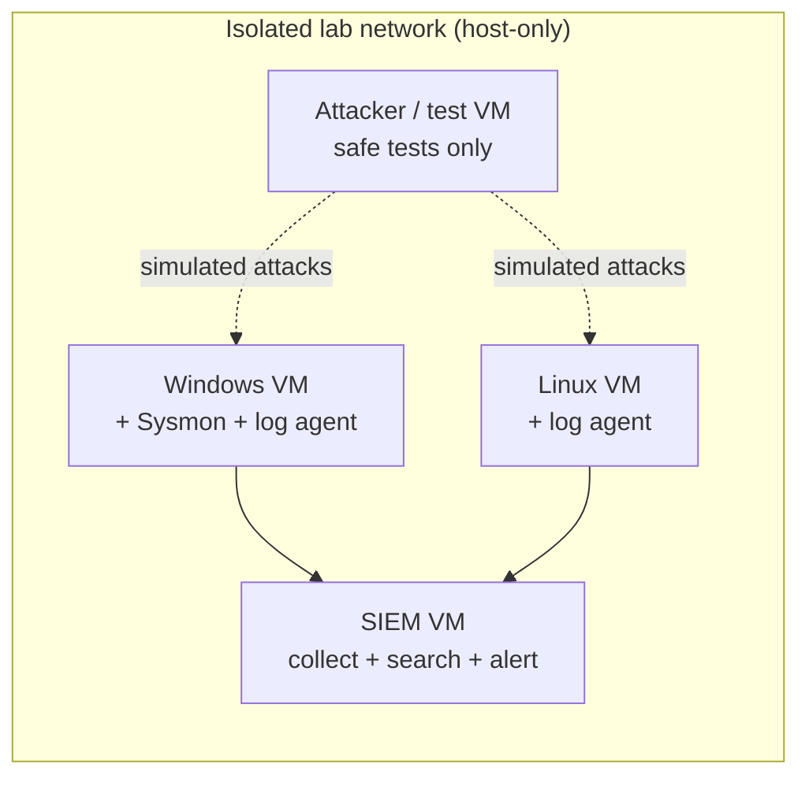

# 18. Build a Home Lab (Optional, Highly Recommended)

Reading gets you started. A lab gets you **hired**: it gives you things to show and talk about.

## 18.1 Safety rules (read first)
- Keep the lab on an **isolated virtual network**, away from your home or work network.
- **Only** attack or scan machines you built yourself.
- Handle malware samples only inside isolated lab machines, with snapshots you can roll back.
- Never put employer or client data in your lab.

## 18.2 What you need
- A computer with virtualisation support. About 16 GB RAM is comfortable; 8 GB is tight.
- Free virtualisation software (VirtualBox, VMware Workstation Player, or similar).
- Time-limited **evaluation** Windows images from Microsoft, plus a free Linux distribution.

## 18.3 Lab map

## 18.4 Build in stages

| Stage | You build | You learn |
|---|---|---|
| 1 | Windows and Linux VMs on a lab-only network | Virtualisation, snapshots |
| 2 | Wireshark on your own traffic | Packets, DNS, TCP handshakes |
| 3 | Sysmon on Windows | Rich endpoint logs |
| 4 | A free SIEM VM (Wazuh, Elastic, Security Onion or similar) | Collection and parsing |
| 5 | Ship Windows and Linux logs into it | Pipelines, normalisation |
| 6 | Dashboards (failed logins, process creation, log-source health) | Reading and building views |
| 7 | 5 to 10 detections | Detection engineering |
| 8 | Safe attack simulations to test them | Purple-team thinking |

## 18.5 Ten exercises

1. Capture a web visit and label the DNS, TCP and TLS steps.
2. Fail logins to your own Windows VM on purpose and find them (Event 4625).
3. Fail SSH logins to your Linux VM and find them in `auth.log`.
4. Install Sysmon and find the process-creation event for `notepad.exe`.
5. Ship those logs to your SIEM and search them.
6. Build a "failed logins by source" dashboard.
7. Write a detection: success after many failures.
8. Write a detection: new member added to the local admins group.
9. Run a safe test for one ATT&CK technique and confirm your detection fires.
10. Write a one-page report of the "incident" using the [template](15-incident-response-and-reporting.md).

## 18.6 Turn it into a portfolio
For each exercise write: **goal → what I did → what I saw (screenshots with nothing sensitive) → what I'd improve**. Put them in a GitHub repo. This is the best answer to "what experience do you have?"

## ✅ After this page you should be able to
- Describe a safe lab layout and why it is isolated
- List the stages from "empty laptop" to "detection tested"
- Show at least three finished exercises with notes
