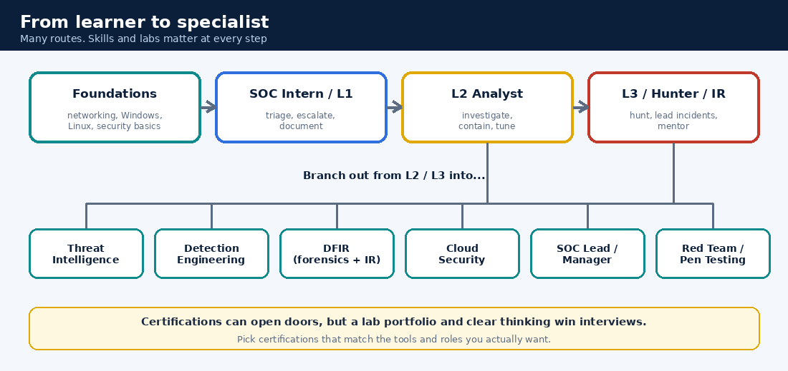

# 19. Career Paths and Transitions

## 19.1 You may be closer than you think

Many people enter SOC from other IT jobs. Their old skills transfer, and they only need to learn to see them **through a security lens**.

| Your background | What already helps | What to add |
|---|---|---|
| **System administrator** | Windows/Linux, Event Viewer, patching, Active Directory, Group Policy, troubleshooting | Detection thinking, SIEM, attacker techniques (ATT&CK), incident reporting |
| **Network administrator** | TCP/IP, DNS, DHCP, firewalls, VPN, packet tools | IDS/IPS, packet hunting, log analysis, security frameworks |
| **IT helpdesk / support** | Ticketing, user handling, triage, calm communication | Networking depth, logs, security fundamentals |
| **Developer** | Scripting, APIs, logic | Operations side: logs, alerts, IR process, web attack patterns |
| **Fresher / non-IT** | Fresh curiosity | Everything in this guide, steadily. Labs matter most for you |

## 19.2 Describe your experience honestly (and well)

Translate what you did into security language, **but only claim what's true.** Interviewers probe. Never invent numbers.

| What you did | A truthful security framing |
|---|---|
| Configured Group Policy | "Applied access-control and hardening policies using Group Policy" |
| Managed patching | "Helped keep systems patched and tracked critical updates" |
| Watched Event Viewer | "Reviewed Windows logs to investigate faults and suspicious activity" |
| Wrote firewall rules | "Wrote and reviewed firewall rules to limit exposure" |
| Administered Active Directory | "Managed user and group access: joiners, movers, leavers, role-based permissions" |
| Fixed outages | "Investigated incidents: identified the cause, restored service, wrote up what happened" |

**Add real numbers only if you know them** (for example "about 80 laptops" or "reduced average ticket time from 2 days to 1"). Say "approximately" if unsure.

## 19.3 A learning path, in stages

| Stage | Focus | You can say afterwards |
|---|---|---|
| 0 | Understand the SOC world: roles, CIA, Kill Chain, ATT&CK | "I know what a SOC does day to day" |
| 1 | Networking, Windows and Linux logs, packets | "I can read raw logs and traffic" |
| 2 | One SIEM in depth (and the idea of others), detections | "I can ingest logs, query and alert" |
| 3 | Triage, IR, IOC investigation, a bit of hunting, SOAR basics | "I can work an alert queue and write a report" |
| 4 | Cloud, compliance, detection engineering, specialisation | "I'm growing toward L2/L3 or a specialty" |

The [8-week plan](08-study-plan-8-weeks.md) and [home lab](18-home-lab-guide.md) put this into practice.

## 19.4 Certifications (optional, pick with care)

Certifications can help you pass a CV screen, but **skills and lab work win interviews**. Prices, formats and syllabi change, so check each provider.

| Level | Examples | Notes |
|---|---|---|
| **Foundations** | CompTIA Security+, CompTIA Network+, Google Cybersecurity Certificate, ISC2 Certified in Cybersecurity (CC) | Good for vocabulary and CV filters |
| **SOC-focused** | Blue Team Level 1 (BTL1), CompTIA CySA+, Microsoft SC-200, vendor SIEM certifications (Splunk, Elastic, IBM QRadar) | Pick what matches the tools your target employers use |
| **Advanced** | GIAC (for example GCIH, GCIA), SANS forensics courses, OSCP (offensive knowledge for defenders), cloud security specialty exams | Often expensive. Usually after some experience |
| **Experience-gated** | CISSP | Typically needs several years of relevant work |

## 19.5 After L1: where can you go?

| Path | What you do |
|---|---|
| **L2 / L3 analyst** | Deeper investigations, lead incidents, mentor |
| **Threat intelligence analyst** | Research actors and campaigns, produce intel |
| **Detection engineer** | Build and tune detections at scale |
| **DFIR (forensics and IR)** | Disk, memory and network forensics, major incident handling |
| **SOC lead / manager** | People, process, reporting, stakeholder communication |
| **Cloud security engineer** | Secure and monitor cloud environments |
| **Red team / penetration tester** | Offensive skills that also sharpen defence |

## 19.6 A steady job-search rhythm
- Build a small **portfolio**: lab write-ups, a few investigations from training platforms, a detection collection.
- Tailor your CV to the posting using the honest framing above.
- Apply regularly (a few applications a week is a sustainable rhythm) and track them.
- Practise [interview questions](10-interview-questions.md) out loud, and a few scenario answers.
- SOC roles appear in managed security providers, banks and financial firms, IT services companies, and product companies. Entry roles are often shift-based, so ask about it.
- Join communities and local meetups. Many roles come through people.

## ✅ After this page you should be able to
- Map your own background to what you already know and what to add
- Rewrite three of your experiences in honest security language
- Name three certification levels and pick one that fits your goal
- Name four paths after L1
