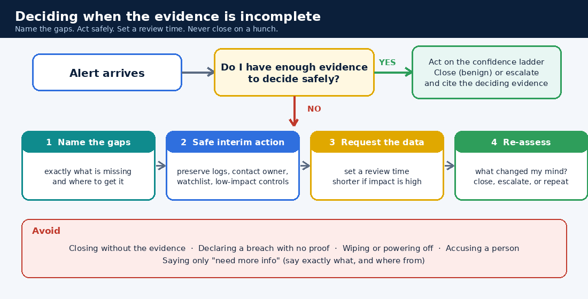

# 20. Investigating with Incomplete Evidence

Real alerts rarely arrive with all the logs you wish you had. An agent might be missing, retention might be short, a source might not be parsed, or the user might be unreachable. **Knowing what to do when the evidence is incomplete is one of the most valuable analyst skills.**



## 20.1 Three possible answers, not two

| Answer | When it fits | The risk if you get it wrong |
|---|---|---|
| **Close** | The evidence clearly shows it's benign | A real attack goes unnoticed (**premature closure**) |
| **Escalate** | The evidence shows (or strongly suggests) harm, or the impact is high enough that you can't wait | Wasted effort, alert fatigue (**over-escalation**) |
| **"Insufficient evidence, keep it open"** | Key facts are missing, you know exactly which ones, and you have a plan to get them | Delay, if you don't set a time limit |

"Insufficient evidence" is a **valid, professional answer**, but only when you can say *exactly* what is missing. "I need more info" isn't an answer. "I need the original email headers and the proxy logs for 14:00 to 15:00, from the mail team and the network team, and I'll review at 16:30" is.

## 20.2 Absence of evidence is not evidence of absence

"No logs found" can mean very different things:

| Why the data is missing | What it tells you |
|---|---|
| Nothing happened | Fine, but you must be able to show the source *was* reporting |
| The agent or log source isn't installed or isn't reporting | A **coverage gap**. The silence may be hiding activity |
| The logs were kept for too short a time | A **retention gap** |
| The logs arrived but weren't parsed or indexed | A **parsing gap**. Your searches can't see them |
| The user or owner can't be reached yet | A **human gap**. Try another channel |

Always check **log-source health** before treating a quiet search as good news.

## 20.3 The evidence map

Before deciding, write four short lists:

| List | Example |
|---|---|
| **What I know** (facts, with where I saw them) | "One sign-in succeeded at 13:52 UTC from a new country (sign-in log)" |
| **What I assume** (flag these!) | "The user is not travelling (no calendar entry)" |
| **What I don't know** (the gaps) | "MFA result, device, what happened after sign-in" |
| **Where I can get it, and how fast** | "MFA and mailbox audit from the identity team, about 30 minutes; user by phone on the known number" |

## 20.4 The confidence ladder

| Confidence | Typical action |
|---|---|
| Confirmed malicious | Contain now, escalate, document |
| Likely malicious | Escalate and contain within your authority, keep gathering evidence |
| Suspicious, evidence incomplete | Keep open, take safe interim steps, short review time, escalate if it can't be resolved |
| Likely benign | Close only if a quick check supports it; document the reasoning |
| Confirmed benign | Close with the evidence cited |

Higher potential impact (privileged accounts, sensitive data, critical systems) means a **shorter tolerance for waiting**.

## 20.5 What would change my mind?

For every open alert, write a small table. It turns a vague worry into a plan:

| If I find... | Then I will... |
|---|---|
| New inbox forwarding rule after the sign-in | Escalate as High, reset credentials, revoke sessions |
| User confirms travel and the device is registered | Close with the confirmation noted |
| Sign-in used a legacy protocol or no MFA | Raise the risk and escalate |

## 20.6 Safe interim actions

| Good (proportionate, reversible, preserves evidence) | Avoid |
|---|---|
| Preserve the logs you have; ask for longer retention | Closing "to keep the queue clean" |
| Contact the owner or user through a trusted channel | Wiping, rebooting or "cleaning up" |
| Add a watchlist or extra monitoring | Accusing a named person |
| Low-impact controls (step-up authentication, rate limiting) with approval | Declaring a breach without evidence |
| Set a review time and an escalation trigger | Large disruptive actions with no approval |

## 20.7 Escalating with unknowns

You can escalate **without** certainty. Say so honestly:

```
POSSIBLE:     <what you suspect, in one line>
EVIDENCE FOR: <facts you have>
MISSING:      <exact gaps, and where each could come from>
RISK IF WRONG:<impact of waiting vs acting>
INTERIM:      <what I've done / recommend now>
REVIEW BY:    <time>
```

## 20.8 A worked example

**Alert:** a new mailbox-forwarding rule was created for a finance user. Mail audit logs are kept for 7 days. The user is on leave. Sign-in logs are available for the last 24 hours only.

1. **Know:** a forwarding rule to an external address was created yesterday at 22:40 UTC (mail audit log).
2. **Don't know:** how it was created (the user's session, an admin, or automation), the user's sign-in history before yesterday, whether mail was actually forwarded.
3. **Interim (safe):** preserve the audit entry, contact the user's manager for a trusted way to reach the user, and ask the mail team whether any mail was forwarded. Ask for longer retention on sign-in logs.
4. **What would change my mind:** sign-in from an unusual place near 22:40, or forwarded mail containing sensitive data, means escalate as High and reset credentials. A request from the user's manager confirming a delegate set it up means close with that record.
5. **Time-box:** review in two hours. Escalate if the user can't be reached, because finance data is involved.

Notice what you did *not* do: close it, declare it a breach, or disable the account without approval.

## 20.9 How this section is scored

You'll work through **evidence cases** with your AI tutor or a mentor (see `ai/evidence-cases.json`). Each case has an alert and the evidence available. You'll answer five prompts:

1. Close, escalate, or insufficient evidence?
2. What evidence supports that, and what exactly is missing?
3. How would different findings change your decision?
4. What safe interim action will you take, and when will you review?
5. Write a 3-line ticket note.

**Reasoning is scored separately from quiz accuracy** and appears on your progress card (cases graded, average reasoning, premature closes, and a short judgment label). Some cases have enough evidence, and some don't. **Answering "insufficient" every time is not safe**: vague answers earn few points, and so does over-caution when the evidence is already strong. The skill is telling the two apart.

## ✅ After this page you should be able to
- Explain why "no logs" is not the same as "nothing happened"
- Give three possible answers to an alert and when each fits
- Build an evidence map and a "what would change my mind" table
- Choose safe interim actions and set a review time
- Escalate honestly with unknowns stated
